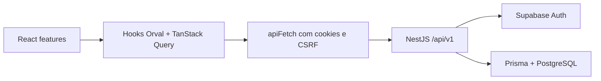

# Arquitetura do frontend por funcionalidades

Data: 22 de julho de 2026  
Estado: atualizado após a Etapa 22.

## Resultado

`App.tsx` monta providers e router. A rota de encomendas orquestra componentes
de apresentação, React Hook Form, estado visual e hooks remotos gerados pelo
Orval. O navegador não conhece tabelas, RPCs, chaves ou clientes Supabase.

```text
apps/web/src/
  app/
    providers/             # QueryClient e políticas de cache
    router/                # rotas React
  features/
    auth/                  # sessão por /auth/* e contexto seguro de tenant
    orders/                # página, formulário, filtros, mutations e mapeadores
    reports/               # relatórios da API e impressão no browser
    settings/              # reservado para UI administrativa futura
  shared/
    components/ui/         # componentes visuais reutilizáveis
    hooks/                 # comportamentos genéricos de interface
    lib/                   # tipos de apresentação, datas, quantidade e erros HTTP
  mocks/                   # handlers MSW tipados pelo cliente gerado
  scripts/                 # verificação da fronteira exclusiva /api/v1
```

## Fluxo de dados atual



O frontend nunca envia `tenant_id`. `/auth/me` devolve o contexto verificado;
a troca de empresa usa uma membership opaca validada pelo servidor e elimina o
cache anterior antes de consultar dados no novo contexto.

## Estado

| Tipo de estado                                          | Local                                               |
| ------------------------------------------------------- | --------------------------------------------------- |
| Sessão, catálogo, responsáveis, encomendas e relatórios | TanStack Query por hooks Orval                      |
| Campos de login e encomenda                             | React Hook Form + Zod                               |
| Filtros visuais, dropdowns e modais                     | estado React local                                  |
| Cache de tenant                                         | removido no logout e na troca autorizada de empresa |

Não há Redux ou Zustand. Não há SDK Supabase no workspace web. Tipos de request
e response vêm de `@order-manager/api-client`; os tipos em `shared/lib/domain.ts`
são apenas modelos de apresentação necessários ao visual existente.

## Proteção automatizada

`npm run check:api-boundary --workspace @order-manager/web` impede dependência
da SDK Supabase, variáveis `VITE_SUPABASE_*`, chamadas diretas a `fetch` no
código de produção e reintrodução dos adaptadores legados. `apiFetch` também
recusa em runtime qualquer URL fora de `/api/v1`.
