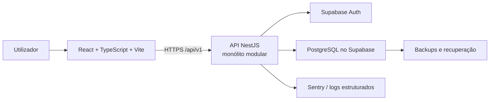

# Arquitetura alvo — visão geral

Data: 15 de julho de 2026  
Estado: desenho aprovado para evolução. A fundação NestJS existe em `apps/api` com configuração, health e Swagger; Prisma, autenticação, persistência, regras de negócio, CI e as demais ferramentas de produto continuam pendentes.

## Objetivo

Evoluir o Order Manager para um produto comercial multiempresa, seguro e sustentável, preservando os fluxos atuais de encomendas, catálogo, responsáveis, filtros e impressão. A solução prioriza clareza, entrega gradual e segurança de tenant, não complexidade desnecessária.

## Decisão de alto nível

Adotar um **monólito modular**: um frontend React e uma API NestJS, com módulos de domínio bem delimitados, um PostgreSQL partilhado e isolamento lógico por tenant. Não serão criados microserviços neste estágio.



## Stack e responsabilidade

| Camada             | Tecnologia alvo                          | Responsabilidade e justificativa                                                                                    |
| ------------------ | ---------------------------------------- | ------------------------------------------------------------------------------------------------------------------- |
| Frontend           | React + TypeScript + Vite                | Interface rápida, tipada e compatível com a base existente. Vite mantém desenvolvimento e build simples.            |
| Estado remoto      | TanStack Query                           | Cache, invalidação, loading, erro, retry e paginação de dados da API; elimina chamadas manuais dispersas.           |
| Formulários        | React Hook Form + Zod                    | Formulários performantes e validação declarativa compartilhável; Zod também valida limites no cliente antes da API. |
| Estilo             | CSS Modules + design tokens              | Escopo local por componente e tokens para cores, espaçamentos, tipografia e impressão consistentes.                 |
| API                | NestJS                                   | Controllers, DTOs, guards, serviços, módulos, injeção de dependência, validação e testes com estrutura coerente.    |
| Contrato           | REST `/api/v1` + Swagger/OpenAPI         | Fronteira estável e documentada entre aplicações; versionamento evita quebrar clientes.                             |
| Cliente gerado     | Orval                                    | Gera tipos e hooks/clients a partir do OpenAPI, reduz divergência manual entre UI e API.                            |
| Autenticação       | Supabase Auth                            | Sessão verificável e gestão de identidade; a aplicação não armazena passwords próprias.                             |
| Persistência       | PostgreSQL Supabase + Prisma             | PostgreSQL maduro; Prisma centraliza schema, queries e migrations de domínio no backend.                            |
| Segurança de dados | RLS Supabase                             | Defesa adicional contra falha de filtro de tenant na API; não substitui autenticação/autorização do backend.        |
| Mocks              | MSW                                      | Simula a API no browser/testes sem Supabase, dados reais ou rede.                                                   |
| Testes             | Vitest, Jest, Supertest, Playwright      | Pirâmide: utilitários/UI, backend, HTTP e fluxos completos.                                                         |
| Operação           | Docker + GitHub Actions                  | Ambientes reproduzíveis e validação automática antes de entrega.                                                    |
| Observabilidade    | Logs estruturados, Sentry, health checks | Diagnóstico de falhas, rastreio por requisição e disponibilidade operacional.                                       |

## Por que monólito modular, não microserviços

O produto ainda tem um domínio pequeno e fortemente relacionado: encomendas, itens, catálogo, responsáveis, identidade e tenant usam as mesmas transações, permissões e dados. Microserviços adicionariam rede, deploys, contratos distribuídos, observabilidade e consistência eventual sem resolver uma necessidade atual.

O monólito modular preserva separação real de responsabilidades dentro de uma única API implantável. Cada módulo terá controller, DTOs, serviço, repositório/acesso Prisma, regras de autorização e testes próprios. Uma extração futura só é considerada quando houver limite operacional ou de domínio comprovado.

## Módulos previstos da API

```text
apps/api/src/
  auth/                 # valida sessão Supabase e contexto autenticado
  tenants/              # tenant, settings e troca de contexto validada
  memberships/          # OWNER, ADMIN e OPERATOR
  orders/                # encomendas, itens, número sequencial, concorrência
  catalog/               # produtos de catálogo por tenant
  responsibles/          # responsáveis por tenant
  audit/                 # gravação e consulta controlada de auditoria
  health/                # liveness/readiness
  common/                # guards, filtros, erros, contexto, logger
  prisma/                # cliente e transações
```

## Ciclo de entrega e qualidade

1. Backend atualiza DTOs e OpenAPI em `/api/v1`.
2. Orval gera o cliente TypeScript versionado/validado no frontend.
3. UI consome o cliente por hooks TanStack Query; não acede às tabelas Supabase.
4. MSW reproduz o contrato nos testes de interface.
5. Vitest/Jest/Supertest/Playwright executam em níveis complementares.
6. GitHub Actions bloqueia merge se lint, typecheck, testes, build ou verificações de segurança falharem.

## Segurança, privacidade e multitenancy

As decisões de dados detalhadas estão em [database-target-design.md](C:/Users/rodri/Desktop/order-manager-main/docs/database-target-design.md) e [multitenancy-rules.md](C:/Users/rodri/Desktop/order-manager-main/docs/multitenancy-rules.md). A regra inegociável é:

> O frontend nunca escolhe, envia, persiste ou filtra `tenant_id`. O backend resolve o tenant a partir da sessão autenticada e da membership ativa.

Dados pessoais como nome e telefone são minimizados, não entram em logs técnicos, possuem retenção aprovada e são auditados. A exportação, exclusão e restauração seguem políticas RGPD e não podem ignorar backup, retenção legal ou auditoria.

## Limites desta decisão

Esta documentação não altera a autenticação atual, não cria API, não instala dependências e não substitui a auditoria real do Supabase. O schema, RLS e RPCs atuais precisam ser confirmados antes da primeira migration.
