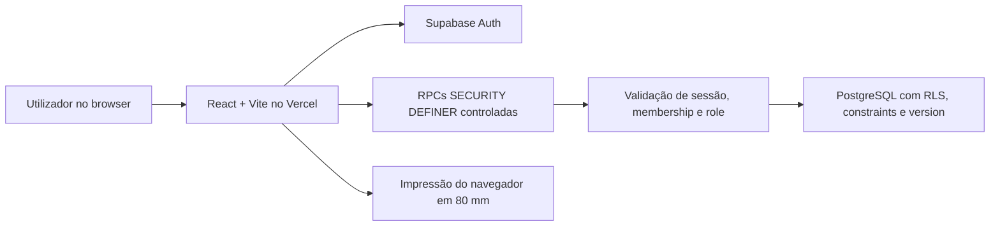

# Arquitetura atual

Atualizado em 26 de julho de 2026.

## Decisão

O produto atual usa uma SPA React no Vercel e o Supabase como identidade, autorização, banco e
camada de operações. Esta arquitetura reduz operação e custo para o piloto de uma pastelaria sem
abrir mão de isolamento por empresa, RLS ou transações.

Não existe um serviço NestJS entre o browser e o Supabase. Os documentos que descrevem NestJS,
Prisma, Orval, Render ou Docker são históricos.

## Fronteiras

| Camada                | Responsabilidade                                         |
| --------------------- | -------------------------------------------------------- |
| componentes React     | apresentação, acessibilidade e estado visual             |
| React Hook Form + Zod | estado e validação amigável dos formulários              |
| TanStack Query        | leituras remotas, invalidação e atualização do dashboard |
| `supabaseData.ts`     | contrato único entre features e RPCs                     |
| RPCs PostgreSQL       | autenticação efetiva, autorização, tenant e transações   |
| constraints + RLS     | integridade e defesa adicional                           |

## Autorização

- `OWNER`: encomendas e acesso gerencial protegido por segunda senha.
- `OPERATOR`: encomendas, filtros, conclusão e impressão; não altera catálogo ou responsáveis.
- o frontend oculta a gestão para `OPERATOR`;
- a RPC recusa a gestão mesmo se alguém tentar chamá-la manualmente;
- o tenant vem da membership da sessão e nunca do browser.

## Evolução

Uma API própria só deve ser reintroduzida quando houver necessidade concreta, como integrações
externas, tarefas assíncronas, regras que não devam existir em RPCs ou escala operacional. Até lá,
duplicar Supabase com NestJS/Prisma aumentaria custo e pontos de falha sem benefício proporcional.
