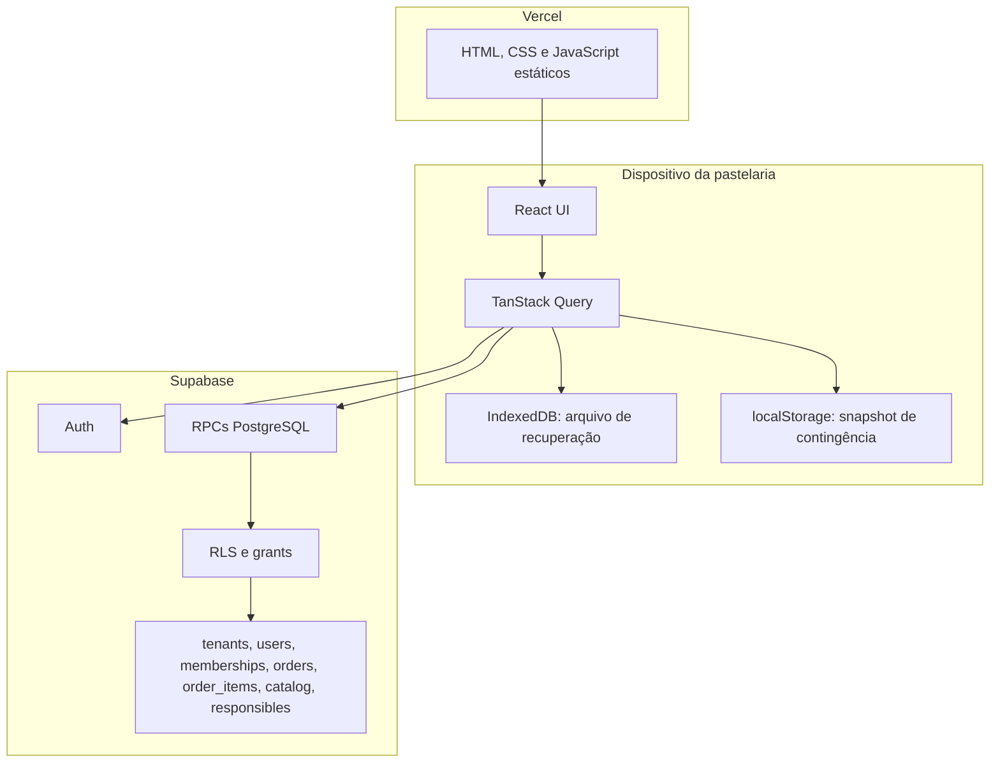

# System design atual

Atualizado em 25 de julho de 2026.

## Componentes

## Consistência

- criação e atualização de encomenda e itens ocorrem numa transação;
- `version` evita sobrescrever uma edição concorrente;
- o número da encomenda é sequencial e único dentro do tenant;
- conclusão marca a encomenda, remove-a das listas ativas e a retém por sete dias;
- exclusão direta é lógica;
- o dashboard invalida as consultas depois de criar, editar, concluir ou apagar;
- a ordenação final continua sendo data e hora de entrega, não a última alteração.

## Disponibilidade

Uma falha de leitura pode ativar o snapshot local somente leitura. Uma resposta válida com zero
encomendas é um estado normal. Escritas offline são bloqueadas porque sincronização sem fila
idempotente poderia duplicar ou perder encomendas.

## Impressão

O documento de impressão tem largura máxima de 75 mm dentro de uma página de 80 mm, cabeçalho por
encomenda, margens pequenas e altura automática. CSS não consegue alterar com garantia o tamanho
configurado no driver; a impressora deve usar bobina de 80 mm e escala 100%.

## Segurança

- somente a chave `anon`/publishable pode estar no Vercel;
- RLS está ativa e acesso direto às tabelas é revogado;
- RPCs expostas validam `auth.uid()`, membership, role, tenant e desbloqueio quando necessário;
- password, token e conteúdo integral de encomendas não são escritos em logs;
- exports JSON contêm PII e devem ser cifrados e guardados fora do equipamento de operação.
