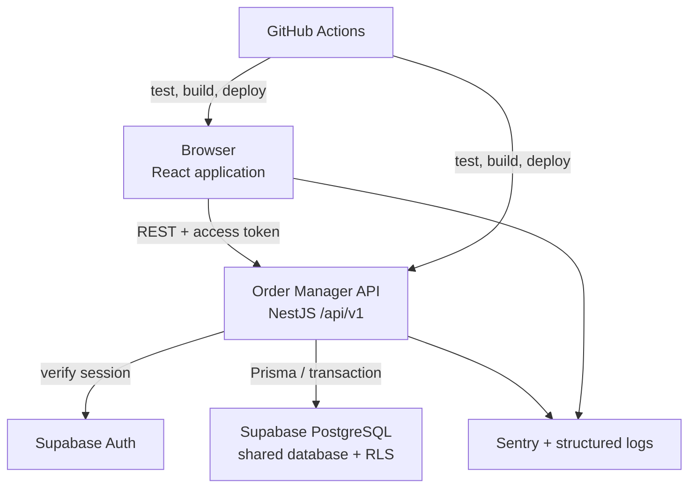
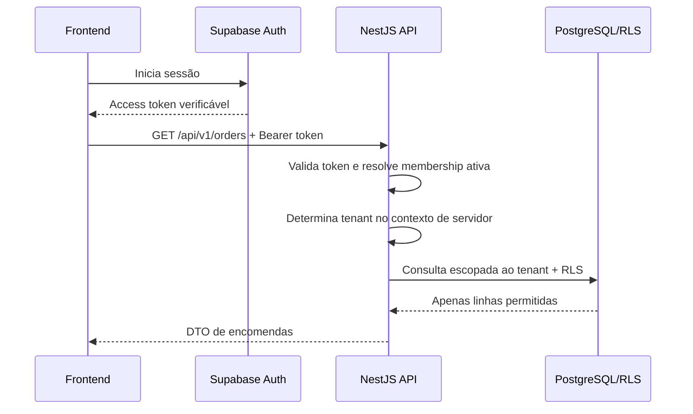
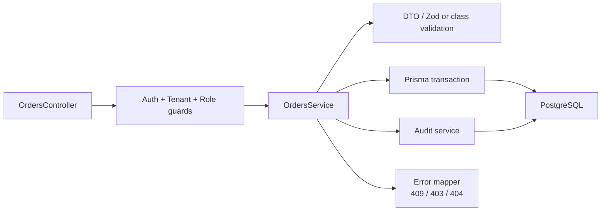
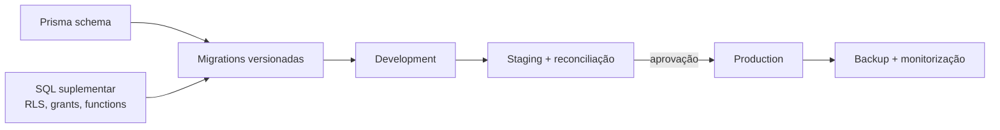
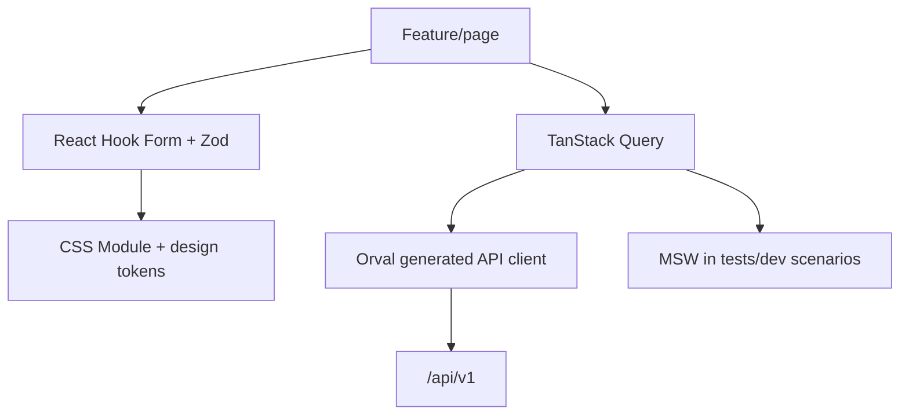

# System design — Order Manager

Data: 15 de julho de 2026  
Estado: arquitetura alvo com fundação inicial implementada em `apps/api`: prefixo `/api/v1`, health, Swagger, segurança HTTP e módulos vazios. Persistência, autenticação, autorização e regras de negócio permanecem pendentes.

## Contextos e fronteiras

O browser deixa de ser cliente direto de tabelas e RPCs. Ele fala exclusivamente com `/api/v1`; Supabase Auth pode ser usado para obter sessão, mas a API é quem autoriza operações de negócio, resolve tenant e aplica regras.

## Fluxo autenticado e tenant

O request de recursos não inclui `tenant_id`. Uma troca de contexto, quando o utilizador tiver memberships em mais de uma empresa, é uma operação de sessão controlada pelo backend: ele valida a membership e assina/atualiza o contexto. Não há endpoint de encomenda que aceite tenant arbitrário.

## Organização modular da API

O módulo `orders` cria cabeçalho, itens, próximo número por tenant e audit log numa transação única. Atualizações exigem `version`; conflito retorna `409`, sem substituir alterações recentes. Os módulos de catálogo e responsáveis seguem o mesmo padrão de tenant e auditoria.

## Persistência, Prisma e migrations

Prisma é o acesso de domínio do NestJS e o mecanismo principal de migrations versionadas para tabelas, índices e constraints suportados. Cada migration é revisada, aplicada primeiro em desenvolvimento/staging e testada com dados sintéticos ou anonimizados.

RLS, grants, extensões PostgreSQL, funções de auditoria e políticas Supabase que não forem expressáveis no Prisma vivem em migrations SQL suplementares, versionadas e executadas pela mesma pipeline controlada. Não existem alterações manuais no dashboard como fonte única de verdade.

Production só recebe migration após backup verificável, ensaio de restauro, plano de rollback e autorização explícita. Nenhuma migration é executada como efeito de build da aplicação.

## Contrato REST e OpenAPI

| Elemento     | Regra                                                                                     |
| ------------ | ----------------------------------------------------------------------------------------- |
| Prefixo      | `/api/v1` em todas as rotas públicas.                                                     |
| Recursos     | Nomes plurais: `/orders`, `/catalog-products`, `/responsibles`, `/memberships`.           |
| Tenant       | Nunca em path, query ou body de recurso; vem da sessão.                                   |
| Validação    | DTO validado no NestJS; erros usam formato consistente.                                   |
| Paginação    | Cursor ou página explícita, metadados e limites máximos.                                  |
| Concorrência | `version` em resposta e comando de atualização; `409 Conflict` quando desatualizada.      |
| Documentação | Swagger publicado a partir da especificação OpenAPI gerada pela API.                      |
| Cliente      | Orval gera tipos e client/hooks a partir do OpenAPI, sem tipos duplicados escritos à mão. |

Exemplos de respostas: `401` sem sessão válida, `403` sem papel, `404` para recurso ausente ou de outro tenant, `409` para conflito de versão, `422` para regra de negócio/validação semântica.

## Frontend

- TanStack Query detém somente estado remoto e invalida queries após mutações bem-sucedidas.
- Estado efémero de UI (modal aberto, busca digitada, seleção local) permanece no componente/feature, não em cache remoto.
- React Hook Form controla formulário; Zod fornece validação local e inferência de tipos. A API continua sendo autoridade final.
- CSS Modules evitam colisões e tokens em CSS custom properties definem a linguagem visual compartilhada.
- Orval é executado contra OpenAPI versionado/gerado na CI; alterações de contrato quebram cedo.

## Testes e qualidade

| Nível             | Ferramenta                     | Foco                                                            |
| ----------------- | ------------------------------ | --------------------------------------------------------------- |
| Funções e React   | Vitest + React Testing Library | regras puras, componentes, estados loading/erro e formulários.  |
| Mocks de contrato | MSW                            | respostas REST realistas sem rede ou Supabase.                  |
| API               | Jest + Supertest               | controllers, guards, DTOs, erros, transações e autorização.     |
| E2E               | Playwright                     | login, encomenda, impressão, permissões e isolamento de tenant. |

Casos de segurança obrigatórios incluem duas empresas sintéticas, tentativa de UUID cruzado, tenant forjado, papel insuficiente e conflito de versão.

## Operação

Docker define imagens reprodutíveis para frontend e API; composição local inclui apenas dependências de desenvolvimento autorizadas. GitHub Actions executa instalação determinística, lint, typecheck, testes, build, geração/verificação de OpenAPI/Orval e, quando existir, testes de integração contra banco descartável.

Cada serviço expõe:

- `liveness`: processo está vivo;
- `readiness`: dependências essenciais disponíveis, sem executar escrita;
- logs JSON com `request_id`, actor, tenant resolvido, rota, status e duração;
- Sentry para exceções, com PII redigida e tags de versão/ambiente;
- alertas de erro, indisponibilidade, latência e falha de migration.

Logs e Sentry nunca recebem passwords, tokens, nome, telefone ou notas completas. Acesso operacional de suporte é limitado, auditado e sujeito à política de privacidade.

## RGPD, auditoria e recuperação

Nome e telefone são dados pessoais. A finalidade, retenção, exportação, eliminação e acesso de suporte devem ser documentados antes de comercialização. Soft delete não é purge: a remoção física respeita prazo aprovado, backup, obrigação legal e audit log. Backups, RPO/RTO e testes de restauro são requisitos de operação, não recursos opcionais.
