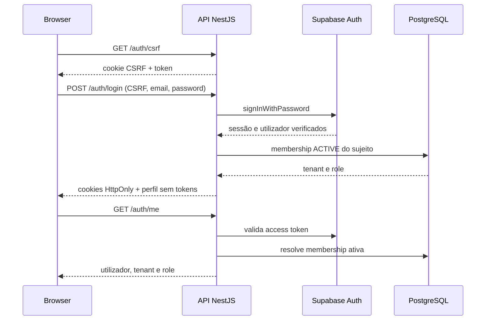

# Autenticação, sessão e isolamento de tenant

Data: 16 de julho de 2026  
Etapa: 11 — autenticação, tenant e permissões.

## Implementação

A API NestJS usa Supabase Auth como origem de identidade. O fluxo é:



Endpoints:

- `GET /api/v1/auth/csrf`: emite token CSRF.
- `POST /api/v1/auth/login`: exige CSRF e cria sessão.
- `POST /api/v1/auth/refresh`: exige CSRF e renova sessão.
- `POST /api/v1/auth/logout`: exige CSRF, tenta revogar a sessão remota e limpa cookies locais.
- `GET /api/v1/auth/me`: exige sessão válida e devolve identidade, tenant ativo e papel.

Os access e refresh tokens não são devolvidos no JSON nem gravados em `localStorage`. São cookies `HttpOnly`, `SameSite=Lax`; `Secure` é ativado em produção. Operações mutáveis de sessão usam double-submit CSRF (`om_csrf_token` + header `X-CSRF-Token`). O frontend deverá obter um token antes de login/refresh/logout e limpar cache TanStack Query no logout em etapa própria.

## Tenant e permissões

`AuthGuard` é global. Ele aceita bearer token apenas para integração/Swagger e, para browser, o cookie HttpOnly. Em ambos os casos a API valida o token com Supabase Auth e procura `tenant_memberships` com `status=ACTIVE` pelo `userId` verificado. O navegador nunca informa `tenant_id`, role ou identidade efetiva.

`CurrentUser()` e `CurrentTenant()` disponibilizam somente o contexto verificado. `RoleGuard` trabalha com `@Roles(OWNER, ADMIN, OPERATOR)` e deve ser aplicado nos controllers de negócio quando estes forem criados. Todo repositório futuro recebe `TenantContext` e deve filtrar por `tenant_id`, inclusive buscas por UUID, alterações, impressão e exportação.

Nesta primeira versão há apenas um tenant ativo por contexto: a membership ativa mais antiga é escolhida pelo servidor. A troca de empresa não foi implementada; ela exigirá endpoint próprio, validação de membership e contexto de sessão assinado pelo servidor. Nenhuma rota de dados de negócio existe ainda.

## Configuração segura

`apps/api/.env` deve conter apenas:

```dotenv
SUPABASE_URL=https://seu-projeto.supabase.co
SUPABASE_ANON_KEY=chave-anon-publicavel
```

O backend não usa nem exige `SUPABASE_SERVICE_ROLE_KEY`. Essa chave nunca pode ser adicionada a `apps/web`, variáveis `VITE_*`, logs, documentação com valores reais ou repositório. A API também continua a exigir `DATABASE_URL`, que fica no servidor.

## Testes e limites

Os testes de API cobrem login/logout com mocks, CSRF, sessão ausente, resolução de tenant baseada no sujeito validado e negação de role para OPERATOR. Não há teste contra um projeto Supabase ou PostgreSQL real nesta etapa: não foram fornecidas credenciais, não foi iniciado Docker e nenhuma migration foi executada.

Antes de ativar em staging, configurar Supabase Auth (utilizadores, método de login, URLs permitidas e expiração), aplicar schema/RLS somente pelo plano aprovado e executar testes HTTP com dois utilizadores reais de tenants distintos. O login implementado é por e-mail e password; a migração do legado `login_app_user`/username depende do plano de utilizadores ainda não auditado.
