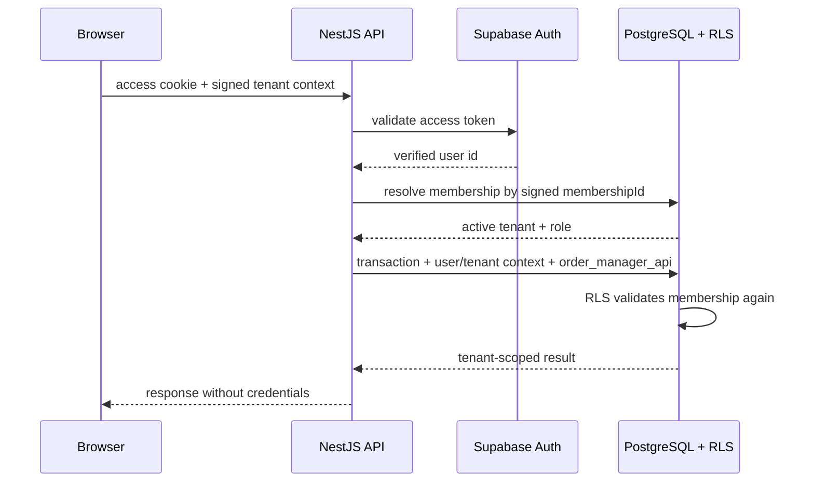

# Etapa 19 — Supabase Auth, memberships, tenant ativo e RLS

Atualizado em 20 de julho de 2026. A implementação e todos os testes desta etapa foram executados exclusivamente no PostgreSQL local `order_manager_dev`. Nenhum projeto Supabase externo foi acessado ou alterado.

## Resultado

A autorização deixou de depender apenas de filtros escritos nos repositories. Cada pedido de negócio passa por quatro verificações:

1. o NestJS valida o access token no Supabase Auth;
2. `public.users` é sincronizada de forma idempotente com a identidade verificada;
3. o cookie HttpOnly assinado `om_tenant_context` aponta para uma membership ativa pertencente ao utilizador;
4. a operação inteira executa numa transação PostgreSQL com `SET LOCAL ROLE order_manager_api`, `app.current_user_id` e `app.current_tenant_id`.

O RLS consulta novamente `tenant_memberships`, o estado do tenant e o estado do perfil. Um papel ou tenant escrito pelo cliente nunca é usado como autoridade.

## Regra obrigatória de tenant

O frontend nunca envia `tenant_id` para selecionar o âmbito de uma operação. A troca usa `POST /api/v1/tenants/switch` com um `membershipId` opaco. O backend confirma que essa membership pertence à identidade autenticada, está `ACTIVE` e aponta para um tenant `ACTIVE`; só então emite um novo cookie assinado.

Quando há várias memberships e não existe uma default explícita, o backend devolve `ACTIVE_TENANT_REQUIRED`. Não existe fallback para “a membership mais antiga”. Uma membership única pode ser usada automaticamente; o primeiro tenant do utilizador torna-se default.

## Endpoints

| Método e rota                          | Contexto               | Regra                                                                    |
| -------------------------------------- | ---------------------- | ------------------------------------------------------------------------ |
| `GET /auth/csrf`                       | público                | emite token double-submit                                                |
| `POST /auth/login`                     | público + CSRF         | valida Supabase, sincroniza perfil e cria sessão                         |
| `POST /auth/refresh`                   | refresh cookie + CSRF  | roda tokens e revalida o tenant ativo                                    |
| `POST /auth/logout`                    | CSRF                   | encerra sessão e limpa access, refresh, CSRF e tenant context            |
| `GET /auth/me`                         | tenant ativo           | devolve identidade, tenant e papel verificados                           |
| `GET /tenants/memberships`             | identidade             | lista apenas memberships do próprio utilizador                           |
| `POST /tenants`                        | identidade + CSRF      | cria tenant, settings e primeira membership `OWNER` numa transação       |
| `POST /tenants/switch`                 | identidade + CSRF      | valida `membershipId` e troca o contexto assinado                        |
| `POST /tenants/memberships/:id/accept` | identidade + CSRF      | aceita apenas convite do próprio utilizador                              |
| `POST /tenants/memberships/invite`     | `OWNER`/`ADMIN` + CSRF | convida pela API administrativa do Supabase; `ADMIN` não convida `OWNER` |
| `PATCH /tenants/memberships/:id`       | `OWNER`/`ADMIN` + CSRF | ativa, suspende, revoga ou altera papel                                  |

Mutações autenticadas por cookie exigem cookie `om_csrf_token` e header `X-CSRF-Token` iguais. Autenticação Bearer não usa cookies e é isenta dessa verificação.

## Ciclo de memberships

- `INVITED`: criada após o provedor de identidade aceitar o convite;
- `ACTIVE`: permite selecionar o tenant;
- `SUSPENDED`: bloqueia acesso sem apagar histórico;
- `REVOKED`: mantém auditoria e preenche `revoked_at`/`revoked_by`.

`OWNER` pode gerir todos os papéis. `ADMIN` pode gerir `ADMIN` e `OPERATOR`, mas nunca criar, alterar ou remover `OWNER`. `OPERATOR` não gere memberships. Serviço e trigger PostgreSQL bloqueiam suspensão, revogação ou despromoção do último `OWNER` ativo; um advisory lock por tenant evita corrida entre alterações simultâneas.

## Sincronização de identidade e convites

- Após validar um token, `UsersService.synchronizeIdentity` faz upsert somente do próprio perfil.
- Em Supabase, a migration instala triggers em `auth.users` quando esse schema existe. Insert/update sincroniza `public.users`; delete desativa o perfil, sem apagar histórico.
- O convite usa `SUPABASE_SERVICE_ROLE_KEY` apenas no backend. A chave nunca integra resposta, log, OpenAPI ou bundle do browser.
- O ambiente local não configura a service role e os testes usam um provedor falso; portanto nenhum email real foi enviado.

Antes de ativar convites num projeto Supabase isolado, configurar a URL de redirect permitida, guardar a service role num gestor de segredos e testar o caso de falha entre o convite externo e a criação da membership. Para escala maior, recomenda-se uma outbox/rotina de reconciliação de convites órfãos.

## RLS e permissões

RLS está habilitado e forçado em `users`, `tenants`, `tenant_memberships`, `tenant_settings`, `orders`, `order_items`, `catalog_products`, `responsibles` e `audit_logs`.

| Recurso                            | SELECT                                                            | INSERT/UPDATE                                          | DELETE físico                           |
| ---------------------------------- | ----------------------------------------------------------------- | ------------------------------------------------------ | --------------------------------------- |
| `users`                            | próprio perfil                                                    | próprio perfil verificado                              | bloqueado                               |
| `tenants`                          | membership visível ou tenant recém-criado pelo próprio utilizador | criação própria; alteração por `OWNER`/`ADMIN`         | bloqueado                               |
| `tenant_memberships`               | própria ou gestão do tenant ativo                                 | transições controladas e trigger de papel/último OWNER | bloqueado                               |
| `tenant_settings`                  | membros ativos                                                    | `OWNER`/`ADMIN`                                        | bloqueado                               |
| `orders`, `order_items`            | membros ativos do tenant selecionado                              | `OWNER`/`ADMIN`/`OPERATOR`                             | bloqueado; usa soft delete              |
| `catalog_products`, `responsibles` | membros ativos                                                    | `OWNER`/`ADMIN`                                        | bloqueado; usa soft delete              |
| `audit_logs`                       | `OWNER`/`ADMIN`                                                   | append pelo ator autenticado                           | bloqueado; UPDATE também não tem policy |

As roles Supabase `anon` e `authenticated`, quando existem, perdem acesso direto às tabelas de negócio. O browser comunica com o NestJS. Em produção, `PrismaService` também rejeita acesso a delegates sem um contexto de segurança ativo.

## Migrations

- `20260720000000_auth_tenant_rls`: membership opaca/default, helpers, triggers, policies, grants e bloqueio de acesso direto;
- `20260720010000_rls_policy_corrections`: correções descobertas por testes adversariais para criação de tenant, convite e trigger do último OWNER.

As migrations foram aplicadas e recriadas apenas no banco local. Aplicação em Supabase staging exige backup, teste de restauração, revisão dos papéis existentes e autorização explícita.

## Cobertura executada

- contexto assinado, adulteração e vínculo ao utilizador;
- token expirado, refresh, logout e limpeza de cookies;
- CSRF por cookies e isenção Bearer;
- `OWNER`, `ADMIN` e `OPERATOR`;
- criação de perfil, tenant e primeira membership;
- convite simulado, aceitação e troca segura;
- ativação, suspensão, revogação e último OWNER;
- SELECT sem filtro no repository;
- UUID conhecido de outro tenant;
- INSERT cruzado;
- acesso cruzado nos dois sentidos;
- ausência de tenant ativo;
- auditoria por papel;
- bloqueio de DELETE físico.

## Limitações antes de staging

- Validar login, refresh, logout e envio de email contra um projeto Supabase isolado real; localmente o provedor é simulado.
- Configurar uma credencial PostgreSQL de runtime dedicada que possa assumir apenas `order_manager_api`; nunca usar o utilizador de migration no runtime de produção.
- Rever os templates de email, redirect URLs, expiração de convite, MFA e política de recuperação de conta.
- Executar backup/restauração e os testes RLS no staging antes de qualquer migração real.
