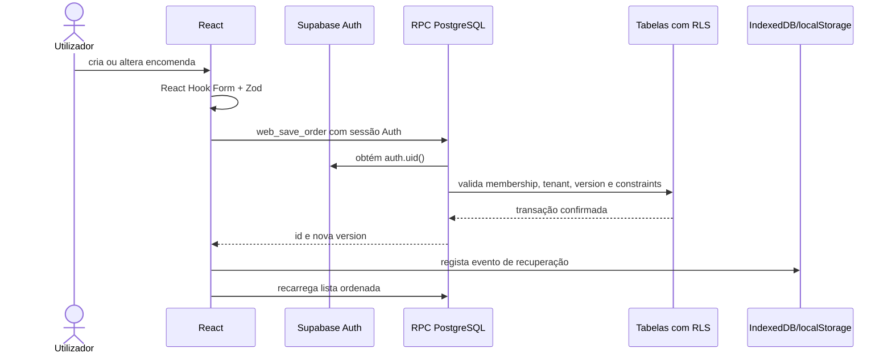

# Sistema atual

Atualizado em 25 de julho de 2026.

## Visão geral

O Order Manager é uma aplicação web para registar, acompanhar, concluir e imprimir encomendas da
Pastelaria Vénus. A versão atual é deliberadamente simples:

```text
React + TypeScript + Vite no Vercel
  -> Supabase Auth
  -> RPCs PostgreSQL
  -> tabelas protegidas por RLS
```

Não existem NestJS, Prisma, Render, Docker ou uma API própria em execução. O browser recebe apenas
a URL e a chave pública do Supabase. `service_role`, connection strings e passwords administrativas
nunca podem entrar no bundle.

## Funcionalidades em uso

- login por nome de utilizador e password;
- opção **Manter conectado** para equipamentos privados;
- papéis `OWNER` e `OPERATOR`;
- segunda senha, validada no PostgreSQL, para a área **Gerenciar**;
- criação, edição, conclusão e exclusão de encomendas;
- responsável escolhido somente da lista;
- catálogo reutilizável, com produto livre permitido na encomenda;
- filtros por área, data e pesquisa textual;
- indicadores globais de total, hoje e próximas;
- impressão individual, detalhada ou com quantidade total por produto;
- formato de impressão preparado para bobina térmica de 80 mm;
- conclusão com retenção no banco por sete dias;
- contingência local somente para consulta e impressão;
- arquivo de recuperação local com histórico de alterações e exportação JSON manual.

## Fluxo de autenticação e autorização

1. O utilizador informa `pastelaria_venus` e a password.
2. O frontend converte o nome visível numa identidade técnica do Supabase Auth.
3. O Supabase cria ou restaura uma sessão.
4. `web_session_context` resolve utilizador, empresa e membership ativa a partir de `auth.uid()`.
5. As RPCs resolvem `tenant_id` novamente no servidor; o frontend não o escolhe.
6. `OPERATOR` trabalha com encomendas. `OWNER` também pode solicitar o desbloqueio temporário da
   área **Gerenciar**.

O cache local guarda apenas o último contexto de apresentação. Se o Supabase não puder confirmar a
sessão, as escritas ficam indisponíveis porque as RPCs também não respondem.

## Fluxo de dados de encomendas



A validação do navegador melhora a experiência, mas não é a fronteira de segurança. Os RPCs,
constraints, foreign keys, versionamento otimista e RLS continuam responsáveis pela integridade.

## Recuperação e contingência

Existem três proteções diferentes:

1. **Snapshot operacional local:** mantém encomendas ativas, catálogo e responsáveis após uma
   leitura válida. Se uma leitura falhar, o painel permite apenas consultar, pesquisar e imprimir.
2. **Arquivo local de recuperação:** IndexedDB regista criação, alteração, conclusão e exclusão,
   além do último snapshot operacional. Ele nunca substitui silenciosamente os dados do Supabase.
3. **JSON externo:** o OWNER pode transferir, em **Gerenciar**, um pacote com o snapshot completo do
   servidor e o arquivo local. É a cópia que deve sair do dispositivo.

O navegador não consegue atualizar automaticamente um ficheiro JSON externo sem nova autorização
ou novo download. Por isso, o histórico é automático no IndexedDB e a cópia fora do dispositivo é
uma rotina manual. Nenhuma dessas proteções equivale a PITR ou backup gerido do PostgreSQL.

## Mapa principal do código

```text
apps/web/src/
  app/
    providers/              TanStack Query e providers globais
    router/                 rotas / e /settings
  features/
    auth/                   login, sessão, cabeçalho e logout
    orders/                 dashboard, filtros, formulário e cartões
    reports/                opções e documento de impressão
    settings/               catálogo, responsáveis e recuperação
  shared/
    components/ui/          controles reutilizáveis e acessíveis
    hooks/                  comportamentos visuais genéricos
    lib/
      supabase.ts           cliente Auth com persistência escolhida
      supabaseData.ts       único adaptador de RPCs
      recoveryArchive.ts    histórico IndexedDB
      contingencyStore.ts   snapshot local somente leitura
  styles/                   tokens, reset, global e impressão

supabase/
  migrations/               schema e evolução versionada
  seeds/                    dados opcionais de demonstração
```

## Regras que não podem ser quebradas

- nunca receber ou enviar `tenant_id` em formulários, URLs ou filtros;
- nunca usar `service_role` no browser;
- toda escrita de encomenda deve continuar transacional;
- toda edição e exclusão deve conferir `version`;
- responsáveis de encomendas vêm da lista ativa;
- observações são opcionais; os outros dados do formulário são obrigatórios;
- uma lista válida vazia não ativa contingência;
- o arquivo local não pode transformar uma falha de backup numa falsa falha da gravação principal;
- só `OWNER` pode desbloquear e usar a área **Gerenciar**;
- alterações de schema entram como nova migration e são testadas antes do projeto em uso.

## Riscos e limites conhecidos

| Risco                          | Proteção atual                                   | Limite restante                                                          |
| ------------------------------ | ------------------------------------------------ | ------------------------------------------------------------------------ |
| Perda de dados no Supabase     | retenção lógica, arquivo local e exportação JSON | sem backup externo recente, ainda há risco de perda                      |
| Perda do dispositivo/browser   | download JSON manual                             | IndexedDB e localStorage também são perdidos                             |
| Internet indisponível          | contingência somente leitura                     | não há gravação offline segura                                           |
| Password partilhada            | Supabase Auth e senha gerencial separada         | recomenda-se equipamento protegido e rotação controlada                  |
| Conflito entre duas edições    | campo `version`                                  | a pessoa precisa recarregar e repetir a alteração                        |
| Impressora configurada como A4 | CSS de 80 mm                                     | o driver ainda deve estar configurado para bobina 80 mm                  |
| Crescimento futuro             | separação por features e tenant                  | uma única empresa não elimina a necessidade de rever acessos ao expandir |
| Bundle inicial grande          | compressão Vite                                  | code splitting pode ser adotado se a rede/dispositivo mostrar lentidão   |

## Estado de prontidão

O código pode ser entregue para piloto depois de toda a suite local passar, a migration mais recente
estar aplicada no Supabase correto e o fluxo publicado ser testado no dispositivo e na impressora
reais. A aprovação final está registada em [release-readiness.md](release-readiness.md).
