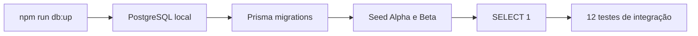

# Integração PostgreSQL e Prisma

Data: 17 de julho de 2026  
Etapa: 18 — PostgreSQL real de desenvolvimento e integração Prisma

## Ambiente validado

- Docker Desktop com engine `29.6.1` e Compose `5.3.0`;
- PostgreSQL `16-alpine` em container local;
- porta publicada somente em `127.0.0.1:5432`;
- banco `order_manager_dev`;
- volume `order-manager-dev_postgres-dev-data`;
- Prisma Client `7.8.0`;
- migration inicial `20260716000000_init`;
- seed determinístico com Alpha Bakery e Beta Bakery.

Nenhuma URL de produção, `service_role` ou dado Supabase foi utilizado.

## Fluxo reproduzível



Comandos:

```bash
npm run db:up
npm run db:reset
npm run db:check --workspace @order-manager/api
npm run test:db
```

## Cobertura real

A suíte `database-integration.test.ts` conecta repositories e services reais ao PostgreSQL e valida:

1. URL limitada a localhost e `order_manager_dev`;
2. seed de dois tenants e memberships;
3. leitura de catálogo isolada por tenant;
4. criação, atualização otimista e soft delete de catálogo;
5. leitura de responsáveis isolada por tenant;
6. criação, atualização otimista e soft delete de responsáveis;
7. rollback integral de encomenda, itens, auditoria e sequência quando um item viola constraint;
8. número de encomenda independente por tenant;
9. edição atômica e substituição lógica de itens;
10. conflito real entre edições simultâneas;
11. relatório detalhado e resumo construídos a partir dos dados persistidos;
12. soft delete de encomenda sem remoção física.

Os dados criados pelos testes usam o prefixo `[integration]`, são limpos no início/fim da suíte e não alteram os registros determinísticos do seed.

## Concorrência

PostgreSQL pode abortar uma das transações serializáveis concorrentes. O Prisma representa esse caso como `P2034`. `PrismaService.withTransaction` repete a transação até três vezes somente para esse erro. Depois da primeira escrita, a repetição encontra a versão desatualizada e o service devolve `VERSION_CONFLICT` de maneira previsível.

Callbacks de `withTransaction` devem conter somente operações idempotentes do banco; efeitos externos não devem ocorrer dentro da repetição.

## Recriação comprovada

O banco foi eliminado e reconstruído com sucesso usando `npm run db:reset`. Depois do reset:

- a migration inicial foi reaplicada;
- o seed dos dois tenants foi executado explicitamente;
- `SELECT 1` passou;
- os 12 testes reais passaram novamente.

## Segurança

- comandos destrutivos passam por `assertDevelopmentDatabase`;
- produção é bloqueada;
- host remoto é bloqueado;
- apenas nomes de banco de desenvolvimento/teste são aceitos;
- a porta não fica disponível na rede local;
- `.env` permanece ignorado pelo Git;
- testes comuns continuam usando mocks e não dependem de PostgreSQL ou produção;
- a suíte real só roda pelo comando explícito `npm run test:db`.

## Verificação final

| Verificação                 | Resultado                                                                |
| --------------------------- | ------------------------------------------------------------------------ |
| PostgreSQL health check     | Aprovado.                                                                |
| Publicação de porta         | Somente `127.0.0.1:5432`.                                                |
| Reset + migration + seed    | Aprovado.                                                                |
| Conexão Prisma (`SELECT 1`) | Aprovado.                                                                |
| Integração PostgreSQL       | 12 testes aprovados.                                                     |
| Testes web                  | 35 testes aprovados.                                                     |
| Testes API unitários/HTTP   | 26 testes aprovados.                                                     |
| Lint                        | Aprovado.                                                                |
| Typecheck                   | Aprovado.                                                                |
| Build web/API               | Aprovado.                                                                |
| Dados finais                | 2 tenants, 2 encomendas, 2 itens, 2 produtos e 2 responsáveis fictícios. |

O `format:check` global ainda identifica 53 arquivos anteriores a esta etapa fora do padrão Prettier, incluindo código backend e cliente OpenAPI gerado. Todos os arquivos alterados nesta etapa passam na verificação isolada. Esses 53 arquivos não foram reformatados para evitar uma alteração mecânica ampla e fora do escopo.

O build web conclui com o aviso já conhecido de bundle JavaScript superior a 500 kB. A divisão de bundle deve ser tratada numa etapa específica de desempenho.
