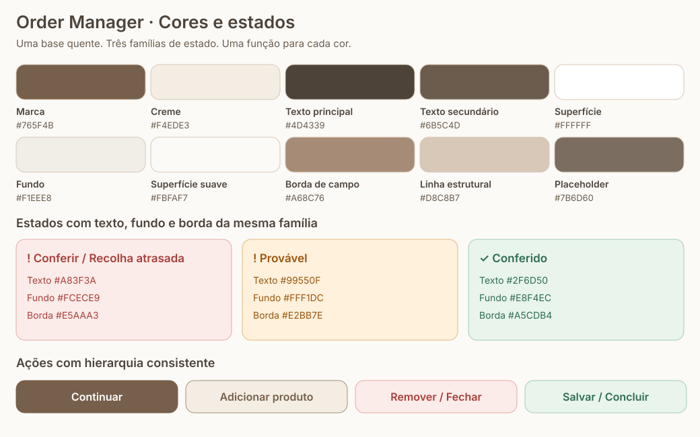

# Style guide do Order Manager

Referência para manter a interface consistente no login, painel, encomendas, formulários, digitalização, gestão e diálogos. Cada capítulo define uma parte do sistema e informa o estado da sua aplicação.

## Capítulos

| Capítulo                                            | Define                                                         | Estado em 12/10/2026                         |
| --------------------------------------------------- | -------------------------------------------------------------- | -------------------------------------------- |
| [Tipografia](typography.md)                         | Família, tamanhos, pesos, entrelinhas e hierarquia             | Aplicado nesta revisão; destino: homologação |
| [Espaçamentos e controles](spacing-and-controls.md) | Espaços, botões, campos, raios, ícones e composição responsiva | Aplicado nesta revisão; destino: homologação |
| [Cores e estados](colors.md)                        | Paleta, alertas, hierarquia de ações, contraste e interação    | Aplicado nesta revisão; destino: homologação |

Os três capítulos estão aplicados no código desta revisão, com publicação destinada somente a homologação. O resultado da integração e do deployment deve ser confirmado na PR; consulte o [registo de release](../operations/release.md). A validação visual usa componentes reais com dados sintéticos e acessos externos bloqueados; não equivale a teste em aparelhos físicos nem a publicação. As exceções ficam documentadas em cada capítulo.

## Como usar

1. Escolha o papel do texto no capítulo de tipografia.
2. Escolha os espaços e as dimensões pelo contexto no capítulo de controles.
3. Escolha o papel da cor e da ação no capítulo de cores e estados.
4. Reutilize componentes compartilhados e variáveis antes de criar novas regras.
5. Confira 320, 390, 768 e 1280 px, incluindo textos longos, foco, hover, seleção, desativado, erro e carregamento.
6. Ao alterar um padrão, atualize o capítulo e o componente compartilhado na mesma mudança.

## Referência visual

Os valores da imagem são derivados de `tokens.css`. A imagem documenta a paleta; não é uma segunda fonte de estilos da aplicação.

## Fontes no código e limites

- [Variáveis visuais](../../apps/web/src/styles/tokens.css): cores, gradientes, sombras, espaços, raios e dimensões.
- [Tipografia](../../apps/web/src/styles/typography.css): escala e papéis de texto.
- [Componentes compartilhados](../../apps/web/src/shared/components/ui): botões, campos, cabeçalhos de seção, ícones, mensagens e diálogos.
- [Desenvolvimento e manutenção](../development/workflow.md): aplicação e validação de alterações.
- A ficha térmica de 80 mm tem suas próprias regras físicas e conserva preto e branco.
- Documentação, implementação local e publicação são estados diferentes. A versão vem de `apps/web/package.json`.

Regra global de cantos: **0,8rem** em toda a interface. Salvar encomenda usa visto verde suave; Cancelar, lixeira vermelha suave; fechar modais, X vermelho suave. Consulte os capítulos para nomes acessíveis, espaçamentos e comportamento.
