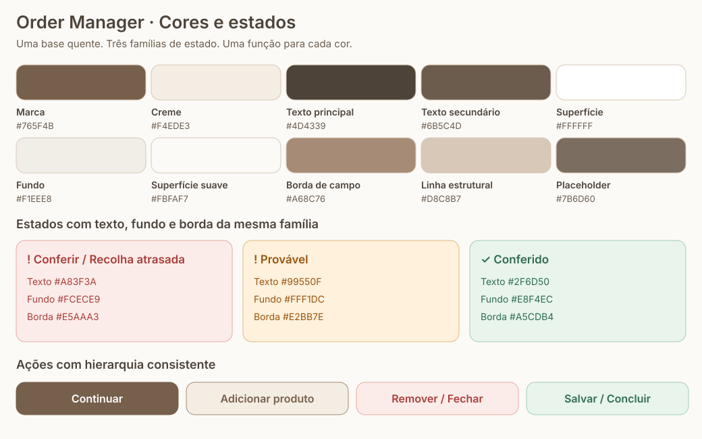

# Style guide · Cores e estados

[Índice do style guide](README.md) · [Tipografia](typography.md) · [Espaçamentos e controles](spacing-and-controls.md)

**Estado em 12/10/2026: aplicado no código desta revisão.** Este capítulo cobre login, painel, encomendas, formulários, digitalização, gestão, mensagens e diálogos. O destino desta revisão é somente homologação; consulte o [registo de release](../operations/release.md) e a PR para o resultado do deployment. A fonte dos valores é [`styles/tokens.css`](../../apps/web/src/styles/tokens.css); a imagem abaixo é uma referência visual da mesma paleta.

## 1. Princípios

- Manter a identidade castanha e creme. Branco e neutros quentes formam a maior parte da tela.
- Usar cor por **função**, não criar uma cor por página ou por botão.
- Reservar vermelho, laranja e verde para estados e ações com esses significados. Não usar uma cor de alerta apenas para decorar.
- Nos alertas, combinar **texto escuro + fundo suave com cor + borda da mesma família**. Não preencher avisos inteiros com cores saturadas nem deixá-los quase indistinguíveis do branco.
- Botões principais, secundários, auxiliares e destrutivos têm papéis distintos. Uma ação auxiliar dentro do formulário não compete com Salvar.
- Cor acompanha texto e símbolo. Não é a única maneira de identificar um estado.
- Preservar as medidas, fontes e áreas de toque definidas nos outros capítulos.

## 2. Paleta base

| Papel                      | Variável                 | Cor       | Aplicação                                                                   |
| -------------------------- | ------------------------ | --------- | --------------------------------------------------------------------------- |
| Marca / ação principal     | `--color-accent`         | `#765F4B` | Continuar, adicionar encomenda, ícones de navegação                         |
| Marca ao passar o ponteiro | `--color-accent-hover`   | `#604C3B` | Hover da ação principal e extremo do gradiente da marca                     |
| Contorno secundário        | `--color-accent-soft`    | `#A58E74` | Botões secundários e ações da barra principal                               |
| Creme                      | `--color-cream`          | `#F4EDE3` | Ação secundária, faixa de data, cartões de produto, seleção                 |
| Areia                      | `--color-sand`           | `#E7D9CC` | Separadores leves e hover secundário                                        |
| Taupe                      | `--color-taupe`          | `#BBA58E` | Detalhes decorativos; não usar em texto necessário para realizar uma tarefa |
| Fundo da página            | `--color-stone`          | `#F1EEE8` | Base quente do fundo e controles desativados                                |
| Superfície suave           | `--color-soft-white`     | `#FBFAF7` | Painéis auxiliares e barra de filtros                                       |
| Superfície                 | `--color-white`          | `#FFFFFF` | Cartões, diálogos, campos e listas abertas                                  |
| Texto principal            | `--color-ink`            | `#4D4339` | Títulos, nomes, produtos e valores dos campos                               |
| Texto secundário           | `--color-muted`          | `#6B5C4D` | Responsável, pedido, telefone, data/hora, ajuda e ações auxiliares          |
| Placeholder legível        | `--color-placeholder`    | `#7B6D60` | Exemplos e indicações de campos ainda vazios                                |
| Linha estrutural           | `--color-line`           | `#D8C8B7` | Contorno de painéis e divisões; não substitui borda de campo                |
| Borda de campo             | `--color-control-border` | `#A68C76` | Inputs, selects, data, hora e observações sobre branco                      |

Os gradientes `--gradient-brand`, `--gradient-page` e `--gradient-login` reutilizam essas famílias e são definidos no arquivo central. Não criar novos tons para o cabeçalho ou para o indicador Total em cada página.

## 3. Estados: três famílias

| Família          | Texto / ícone | Fundo suave | Borda     | Significado                                                            |
| ---------------- | ------------- | ----------- | --------- | ---------------------------------------------------------------------- |
| Vermelho telha   | `#A83F3A`     | `#FCECE9`   | `#E5AAA3` | Conferir, recolha atrasada, erro, cancelar, fechar, remoção e exclusão |
| Laranja caramelo | `#99550F`     | `#FFF1DC`   | `#E2BB7E` | Provável, editar / informação que ainda requer atenção                 |
| Verde            | `#2F6D50`     | `#E8F4EC`   | `#A5CDB4` | Conferido, operação bem-sucedida, WhatsApp, salvar e concluir          |

Cada família expõe `--color-danger`, `--color-warning` ou `--color-success`, acompanhada de `-soft` e `-border`. Não calcular uma borda diferente em cada componente. Hover das ações preenchidas usa `--color-danger-hover` (`#8F302D`) no vermelho e `--color-success-hover` (`#25563F`) no verde.

### Revisão da digitalização

| Estado    | Apresentação                        | Regra de significado                                               |
| --------- | ----------------------------------- | ------------------------------------------------------------------ |
| Conferir  | Vermelho suave, símbolo `!` e texto | A IA pede revisão ou os dados ainda não têm segurança suficiente   |
| Provável  | Laranja suave, símbolo `!` e texto  | Sugestão com maior confiança; ainda não foi confirmada pela pessoa |
| Conferido | Verde suave, símbolo `✓` e texto    | A pessoa confirmou o campo ao alterá-lo                            |

Os três selos têm o mesmo tamanho, peso, raio e preenchimento. Permanecem à direita do rótulo, inclusive quando precisam passar para a próxima linha. A escolha da paleta não muda os critérios de confiança da IA.

### Recolhas atrasadas

- Aviso global: faixa vermelha suave, borda vermelha, relógio, quantidade e ação de texto **Ver**. Não exibe a frase sobre a encomenda mais antiga.
- A ação **Voltar** recupera os filtros anteriores. Nomes acessíveis descrevem a ação completa, mesmo com o texto curto na tela.
- O aviso tem 46 px de altura com texto em uma linha, incluindo bordas. Pode crescer se o texto precisar quebrar; o botão conserva 44 px de área de toque.
- No cartão: selo vermelho da mesma família, dentro do cabeçalho e antes do responsável, com 12 px entre selo e metadados. Sem margem duplicada nem selo colado à faixa de data.
- O tempo continua no selo do cartão e atualiza a cada minuto. Não usar animação, piscar ou aumentar a saturação conforme passa o tempo.
- Se a visualização de atrasadas estiver aberta e já não houver atrasos, o aviso fica neutro e mantém **Voltar**.

### Mensagens gerais

- **Erro:** trio vermelho; acompanhado de uma mensagem que explique o problema.
- **Sucesso:** trio verde; reservado a uma operação concluída. O modal de sucesso tem um resumo verde suave com texto verde centralizado, sem visto, ilustração ou X. Na exclusão, o nome do cliente fica em destaque entre o contexto e o resultado da operação. O rodapé branco separado contém a ação secundária “Voltar para as encomendas”. A leitura com IA abre diretamente o formulário de conferência; não apresenta um modal intermediário de leitura concluída e não salva automaticamente. Depois de apagar, a mensagem identifica o cliente: “Encomenda de [nome do cliente] apagada com sucesso.”
- **Informação:** texto castanho sobre creme com borda neutra. Não introduzir uma quarta família de alerta sem necessidade.
- **Erro de campo:** borda vermelha e mensagem; manter o campo branco para preservar a leitura do valor.

## 4. Hierarquia dos botões

| Papel / variante                        | Aparência                                      | Exemplos                                                  |
| --------------------------------------- | ---------------------------------------------- | --------------------------------------------------------- |
| Principal · `primary`                   | Castanho preenchido, texto branco              | Continuar, nova encomenda                                 |
| Secundário · `secondary`                | Creme, texto castanho, contorno castanho suave | Voltar de uma etapa, imprimir                             |
| Auxiliar · `ghost`                      | Branco, texto secundário, borda neutra         | Ação complementar discreta                                |
| Cancelamento em texto · `danger-subtle` | Vermelho suave, texto e borda vermelhos        | Cancelar/Não em texto, lixeira de remover produto         |
| Remover / descartar · `danger`          | Vermelho preenchido, texto ou ícone branco     | Apagar encomenda, lixeira de cancelar, confirmar exclusão |
| Confirmar · `success`                   | Verde preenchido, texto ou ícone branco        | Salvar encomenda, concluir recolha no cartão ou diálogo   |
| Contacto / adicionar · `success-subtle` | Verde suave, texto e borda verdes              | WhatsApp, adicionar mais um produto (+)                   |
| Editar · `warning`                      | Amarelo suave, texto e borda caramelo          | Editar encomenda, produto ou responsável                  |

Regras de composição:

- No formulário, **Salvar usa verde forte**, **Adicionar mais um produto usa + verde sobre fundo verde suave** e **Remover produto usa lixeira vermelha sobre fundo vermelho suave**. Os botões de adicionar e remover produto têm 44 × 44 px. O botão + fica a 12 px do último cartão, conserva o nome acessível e o título “Adicionar mais um produto” e adiciona um item por clique. Reutilizar as cores da marca e de estado, sem criar tons exclusivos para esses botões.
- **Salvar encomenda:** visto branco sobre fundo verde forte; **Cancelar:** lixeira branca sobre fundo vermelho forte. Ficam nas duas colunas do rodapé, sem texto visível, com nomes acessíveis e títulos que descrevem a ação. A lixeira deste formulário apenas cancela a edição atual; não apaga uma encomenda guardada.
- **Sair dos modais:** não usar X no cabeçalho. Confirmações usam “Não” em vermelho suave; digitalização e impressão usam “Cancelar” em vermelho suave; o formulário de encomenda mantém a lixeira branca sobre vermelho forte. Digitalizar oferece Cancelar em todas as etapas. Confirmações de sucesso usam Voltar para as encomendas. Voltar de uma etapa continua secundário.
- Salvar a encomenda e concluir a recolha usam a mesma família verde, preservando seus nomes e comportamentos distintos. Outros formulários mantêm sua ação principal castanha quando não usam esse rodapé de confirmação.
- Hover altera apenas o tom da mesma família; o secundário usa areia e texto castanho mais escuro para preservar contraste; uma ação vermelha não ganha contorno castanho ao passar o ponteiro.
- Controles desativados usam texto secundário sobre fundo neutro. Não reduzir a opacidade de todo o botão até a legenda desaparecer.
- Ações de texto, como **Ver** no aviso, mantêm a área de toque de 44 px e usam sublinhado para indicar interação.
- Controles invertidos do cabeçalho são uma exceção de superfície: texto claro e preenchimentos translúcidos compartilhados, preservando sua aparência compacta.

## 5. Seções, ícones e leitura

- **Raio único:** `--radius: 0.6rem` (9,6 px na base de 16 px) para botões, campos, cartões, painéis, alertas, menus e modais. Não criar uma escala de raios por tamanho de componente.

- Dados da encomenda e Produtos usam títulos sem fundo, com uma linha areia abaixo e 12 px até os campos ou o primeiro cartão. Cada produto tem seu próprio cartão em creme suave e raio de 0,6rem. O fundo avança 8 px para cada lado e o padding devolve esses 8 px, mantendo os campos alinhados aos dados da encomenda. Não envolver a seção inteira em outro cartão.
- A faixa de data usa texto de 16 px com peso regular, padding vertical de 8 px e ícones de calendário/relógio de 16 px. Data e hora ficam nas extremidades, com quebra de linha quando necessário.
- O cliente aparece com ícone de perfil diretamente antes do nome. Não repetir uma linha visível “Cliente” acima dele. Nome e telefone compartilham o alinhamento do ícone e do texto; o nome conserva a hierarquia de título.
- Ícones adotam `currentColor`, os tamanhos e o traço do capítulo de controles. Não escolher uma cor adicional para cada ícone.
- Fundo branco para campos e dados de leitura; creme para cartões de produto e ações secundárias; fundos coloridos suaves para estados.
- No calendário, dias indisponíveis exibem somente o número com opacidade de 40%, sem fundo ou borda visível. A data selecionada válida mantém o preenchimento castanho; a restrição de seleção permanece intacta.

## 6. Foco, seleção e contraste

O foco de teclado usa `--color-focus` (`#5B78C7`) e o halo `--color-focus-soft`. Esse azul é um indicador de navegação, não uma nova cor de mensagem. O foco deve continuar visível em botões, campos, opções e calendários.

A seleção comum usa castanho/creme. A data selecionada no calendário usa castanho preenchido e texto branco. Destaque de pesquisa usa `--color-highlight` (`#F6DEA6`) com texto principal; não reutilizar esse fundo como estado Provável.

Meta para texto normal: contraste mínimo de **4,5:1**. Os pares de texto e fundo suave dos três estados têm aproximadamente **5,15:1 a 5,43:1**; branco sobre as ações castanha, vermelha e verde também supera 4,5:1. Placeholder é mais escuro que o anterior para continuar legível. Esses cálculos não representam uma auditoria completa de acessibilidade do produto.

Referências: [W3C · contraste mínimo](https://www.w3.org/WAI/WCAG22/Understanding/contrast-minimum.html) e [W3C · uso de cor](https://www.w3.org/WAI/WCAG22/Understanding/use-of-color.html).

## 7. Aplicação e manutenção

1. Escolher o papel semântico antes da cor. Usar `Button`, `Alert`, `ScanFieldLabel`, `FormSectionHeading` e os demais componentes compartilhados.
2. Reutilizar variáveis de `tokens.css`; não escrever hex, RGB, cor nomeada ou mistura em um CSS de componente. O Stylelint bloqueia valores literais e funções de cor fora do arquivo central.
3. Usar os trios de estados completos. Não mudar só o texto e manter um fundo de outra família.
4. Reutilizar os gradientes, a sobreposição dos diálogos e as sombras centrais. Não escurecer uma página por conta própria.
5. Ao alterar a paleta, atualizar este capítulo, sua referência visual e verificar os pares de contraste.
6. Conferir celular de 320 e 390 px, tablet de 768 px e computador de 1280 px; observar texto longo, foco, hover, seleção, desativado e mensagens.

A ficha térmica de 80 mm conserva preto e branco e suas regras físicas próprias. Não levar os fundos coloridos da interface para a impressão.
