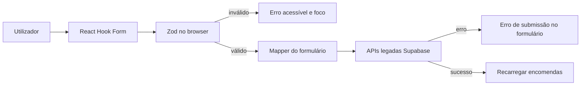

# Formulários e validação do frontend

Data: 17 de julho de 2026  
Etapa: 17 — Formulários com React Hook Form e Zod

## Resultado

Os formulários de login e encomenda passaram a usar React Hook Form para registo de campos, submissão, foco, estado de erro e estado de carregamento. Zod descreve e executa a validação da experiência no navegador. A integração legada com Supabase foi preservada nesta etapa.

Os dropdowns, modais e outros estados exclusivamente visuais continuam em `useState`. Os valores dos campos já não são mantidos em vários estados manuais.

## Responsabilidade de cada camada

| Camada             | Responsabilidade                                                               |
| ------------------ | ------------------------------------------------------------------------------ |
| Zod no browser     | Feedback rápido, formato dos campos e experiência acessível antes do envio.    |
| React Hook Form    | Estado do formulário, arrays de itens, submissão única, loading, erros e foco. |
| DTO NestJS         | Validação independente de toda requisição recebida pela API.                   |
| Service de domínio | Regras de negócio e autorização, incluindo tenant, papel e conflito de versão. |
| PostgreSQL         | Constraints e integridade final dos dados.                                     |

Os schemas Zod do browser não são partilhados automaticamente com Prisma ou com regras internas do banco. O cliente nunca é uma fronteira de confiança.

## Regras implementadas

### Login

- utilizador amigável obrigatório; espaços e acentos são aceites e normalizados apenas para a identidade técnica do Supabase;
- senha obrigatória;
- mensagem de erro retornada pela integração;
- foco automático no primeiro campo inválido;
- botão bloqueado e texto de loading durante a submissão;
- prevenção de submissão duplicada.

### Encomenda e itens

- nome do cliente obrigatório, entre 2 e 160 caracteres;
- telefone opcional, mas limitado a 9–15 dígitos quando preenchido;
- responsável obrigatório e selecionado da lista disponível;
- data obrigatória, no formato `YYYY-MM-DD`, com verificação de data real;
- hora opcional, mas válida no formato `HH:mm` quando preenchida;
- pelo menos um item;
- produto obrigatório;
- quantidade numérica maior que zero;
- unidades permitidas: `UN`, `KG` e `G`;
- observação limitada a 1.000 caracteres.

O responsável permanece obrigatório porque essa era a regra efetiva do formulário anterior: uma encomenda só era guardada quando existia um `responsibleId` válido. Esta decisão preserva o comportamento atual; qualquer mudança para responsável opcional deve ser aprovada como alteração de regra de negócio.

## Fluxo de dados



`orderFormMappers.ts` faz a fronteira entre o modelo do formulário e o formato legado `OrderForm`. As unidades são apresentadas e validadas como `UN`, `KG` e `G`, mas continuam convertidas para o formato legado em minúsculas ao guardar, preservando a compatibilidade atual.

## Acessibilidade

- cada campo possui `label` estável e identificador próprio;
- mensagens usam `role="alert"`;
- campos inválidos recebem `aria-invalid="true"`;
- `aria-describedby` associa o campo à respetiva mensagem sem alterar o seu nome acessível;
- React Hook Form direciona o foco ao primeiro campo inválido;
- botões de submissão são desativados enquanto a operação está pendente.

## Erros e concorrência

Erros comuns de integração são apresentados dentro do formulário e também mantêm a mensagem global já existente. Respostas com código `VERSION_CONFLICT` ou estado HTTP `409` recebem uma mensagem específica e provocam a atualização da listagem.

A integração Supabase legada ainda não envia o campo `version`. Portanto, o tratamento visual de conflito está preparado e testado, mas só será exercitado de ponta a ponta quando o frontend passar a consumir a API NestJS versionada.

## Testes

Foram adicionados testes para:

- schema de login válido e inválido;
- telefone e hora opcionais;
- cliente, telefone, responsável, data e hora inválidos;
- existência e conteúdo dos itens;
- quantidade positiva;
- unidades `UN`, `KG` e `G`;
- reconhecimento de conflito de versão;
- mensagens acessíveis e foco no primeiro erro;
- loading e bloqueio de submissão duplicada;
- envio de uma encomenda válida;
- compatibilidade de quantidades decimais ao editar e guardar;
- erros de autenticação e fluxos de caracterização existentes.

Comandos de verificação:

```bash
npm run test --workspace @order-manager/web
npm run lint
npm run typecheck
npm run build
```

## Limitações atuais

- o frontend continua a chamar Supabase diretamente, conforme o limite desta etapa;
- o conflito otimista completo depende da futura troca para a API NestJS e do campo `version`;
- validações DTO, regras de service e constraints do banco continuam independentes e não foram alteradas;
- testes end-to-end com navegador e backend real permanecem necessários para sessão, concorrência e integração completa;
- nenhuma tabela, migration, policy, RPC ou dado do Supabase foi modificado.

## Verificação da etapa

| Verificação                       | Resultado                                       |
| --------------------------------- | ----------------------------------------------- |
| Prettier nos arquivos desta etapa | Aprovado.                                       |
| `npm run lint`                    | Aprovado no frontend e backend.                 |
| `npm run typecheck`               | Aprovado no cliente gerado, frontend e backend. |
| `npm run test`                    | Aprovado: 35 testes web e 26 testes API.        |
| `npm run build`                   | Aprovado no frontend e backend.                 |

O `npm run format:check` global continua a falhar em 55 arquivos anteriores a esta etapa, principalmente backend, OpenAPI e cliente gerado. Eles não foram reformatados para evitar uma alteração ampla e fora do escopo. O build também mantém o aviso de bundle web superior a 500 kB; o artefato é gerado normalmente e o code splitting deve ser tratado numa etapa própria de desempenho.
